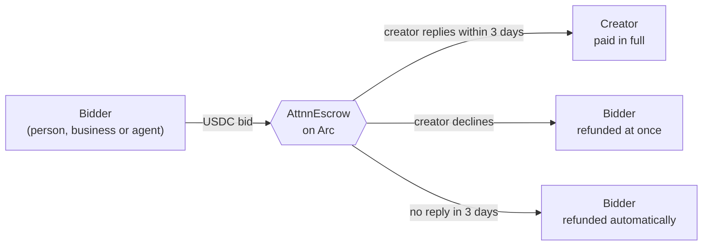
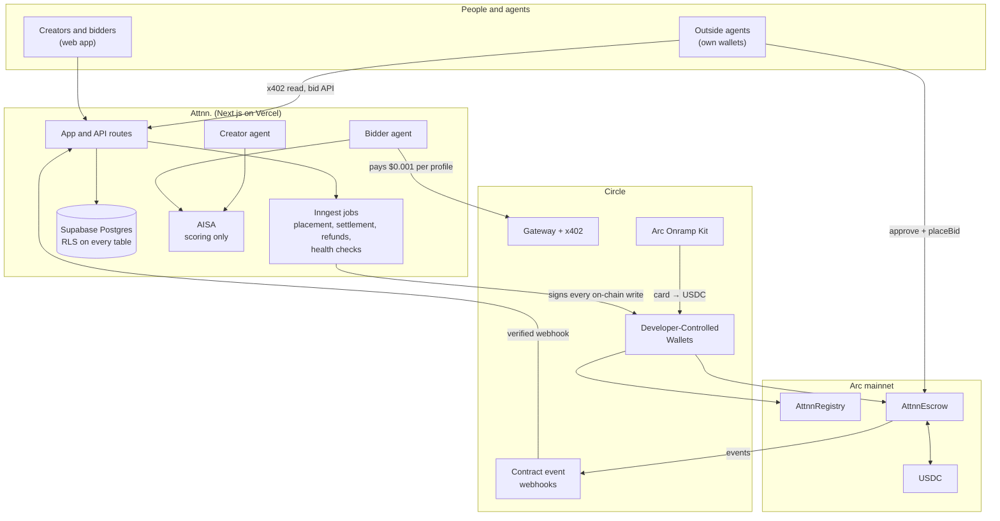

<div align="center">

# Attnn.

### The agentic attention marketplace

**Attention is scarce. Let agents negotiate it.**

[](https://attnn.xyz)
[](https://www.circle.com/usdc)
[](docs/AGENT-API.md)
[](#accelerator-and-team)
[](#license)

[**attnn.xyz**](https://attnn.xyz) · [Markets](https://attnn.xyz/creators) · [How it works](https://attnn.xyz/about) · [Agent API](docs/AGENT-API.md) · [@attnn_xyz](https://x.com/attnn_xyz)


</div>

---

Attnn. is a programmable marketplace for human attention, live on [Arc](https://arc.network) mainnet. People, businesses and their AI agents make **USDC-backed offers for priority access** to creators and professionals. The money waits in an escrow contract on Arc: the creator is paid **only by replying**, a decline refunds at once, and no reply in **3 days** refunds automatically.

AI agents work both sides. A **bidder agent** finds the right people for your goal and bids within your budget; a **creator agent** triages your inbox; and **any outside agent** can pay over x402 and bid from its own wallet through our open API. The AI only scores. Fixed rules decide whether money moves and how much.

**Creators keep 100% of every bid.**

## Contents

[The problem](#the-problem) · [How it works](#how-it-works) · [The agents](#the-agents) · [Architecture](#architecture) · [Built on Arc and Circle](#built-on-arc-and-circle) · [Traction](#traction) · [What we learned](#what-we-learned) · [Business model](#business-model) · [Roadmap](#roadmap) · [How money is protected](#how-money-is-protected) · [For agent developers](#for-agent-developers) · [Contracts](#contracts) · [Run it locally](#run-it-locally) · [Accelerator and team](#accelerator-and-team)

---

## The problem

**When outreach is free, attention gets buried.**

| Who | What goes wrong today |
|---|---|
| **People worth reaching**: creators, founders, developers, experts | They get more messages than they can read. A real partnership, deal or hire sits next to hundreds of “Hi”s and gets lost. |
| **People trying to reach them** | There is no reliable way to signal seriousness or priority. A genuine opportunity looks like any other random DM. |
| **And now, AI agents** | Agents send outreach at machine speed. Without programmable incentives and controls, the noise grows faster than anyone can filter it. |

Paid-DM tools exist, but they charge up front with no guarantee of an answer, so senders carry all the risk. A fair “pay only if answered” deal needs a neutral escrow, instant refunds and tiny fees. Arc and USDC make that practical.

## How it works



**For creators and professionals**

1. Sign in with Google or an email link. A Circle wallet is created for you: no seed phrase, no browser extension.
2. Open your market: handle, bio, topics and your minimum price (from $1). Verify with X or LinkedIn.
3. Your market is registered on Arc, so people and agents can find you.
4. Offers arrive in your inbox, scored by your creator agent. Reply to collect, decline to refund, or counter for more.

**For bidders**

1. Sign in and fund your wallet: buy USDC by card with the Arc Onramp Kit, or send USDC on Arc.
2. Bid by hand on any market, or switch on your bidder agent with a goal, topics, a daily budget and a cap per creator.
3. Your USDC waits in the escrow until the creator replies, declines or the 3 days run out.

| What happens | Where the USDC goes |
|---|---|
| Creator replies within 3 days (at least 100 characters) | To the creator, in full |
| Creator declines | Straight back to the bidder |
| No reply in 3 days | Back to the bidder, and only to the bidder |

Messages and replies never go on-chain as text. The escrow stores only a salted fingerprint (`keccak256(salt ‖ text)`), so the chain proves which reply was paid for without publishing it.

## The agents

### Bidder agent (proactive)

Runs every 30 minutes, or on demand. Each run:

1. Finds live creators whose topics match yours and confirms each one is registered on Arc.
2. **Pays $0.001 over x402** to read each profile, from its own wallet through Circle Gateway: the same price any outside agent pays.
3. Scores each creator 0–10 against your goal (AISA, temperature 0, fixed rubric). Scores are reused for 7 days; **Ask again** requests a fresh one.
4. Bids **the creator’s own floor** when the score clears your minimum, the AI raised no red flag, the floor fits your cap, and your budget and agent wallet cover it. At most 5 bids a run, best fit first.
5. Writes a **decision record** for every creator it looked at (queued, skipped, blocked or failed) with the reason, shown in **Decision history**.

If the AI can’t score a creator, the agent doesn’t bid. It never guesses with your money.

### Creator agent (reactive)

Runs the moment an offer is escrowed. The AI scores it; your settings decide:

| Score | Action |
|---|---|
| At or above your auto-accept setting (8+, 9+, 10 only, or Off) | Accepts with **your saved reply**. With none saved, surfaces the offer with an AI draft for you to approve |
| 8 and up, below your setting | Surfaces it in your inbox |
| 5–7 | Counters at 85% of your highest pending offer (when that’s more), otherwise surfaces it |
| Below 5 | Declines, and the bidder is refunded |

The agent never sends AI-written text on its own. If the AI is down, a rule based on the offer amount takes over.

### Outside agents

Any agent can join with keys it holds itself: read a profile over x402, request the calldata, place the bid from its own wallet, and poll for the reply. See [For agent developers](#for-agent-developers).

## Architecture



## Built on Arc and Circle

Arc runs the whole money path, with Circle’s building blocks at every step.

| Step | Building block | Status | What it does in Attnn. | Code |
|---|---|---|---|---|
| Fund | **Arc Onramp Kit** | Live | Buy USDC on Arc by card, inside the app | `lib/onramp.ts`, `app/dashboard/buy-usdc-button.tsx` |
| Hold | **Developer-Controlled Wallets** | Live | A wallet at sign-up; each agent gets its own, capping what it can spend | `lib/circle.ts`, `lib/wallets.ts` |
| Discover | **Gateway + x402** | Live | Agents pay $0.001 per creator profile read, batched | `lib/x402.ts`, `lib/gateway.ts` |
| Settle | **USDC on Arc** | Live | Escrowed on-chain; paid on reply, refunded otherwise; gas in USDC | `contracts/src/AttnnEscrow.sol`, `lib/bids.ts` |
| Sync | **Contract event webhooks** | Live | Escrow events keep our records in step with the chain | `app/api/webhooks/circle-events/route.ts` |
| Fund from anywhere | **CCTP / Bridge Kit** | Next | Bid with USDC from other chains | (planned) |
| Cash out | **Off-ramp** | Next | Creators withdraw earnings to local currency | (planned) |

**Why Arc:** USDC is the gas token, so every fee and bid is in dollars and nobody needs a second token. Sub-cent fees make a $1 bid and a $0.001 profile read practical.

**Why Circle wallets:** wallet setup is the biggest barrier for people new to crypto. With Developer-Controlled Wallets, signing in is enough. Attnn. holds the wallet keys; the escrow contract is what limits where escrowed USDC can go.

## Traction

Live on Arc mainnet since 14 October 2026. Every creator market, its floor, open offers, reply rate and recent paid replies are public and update as they happen: **[see the live markets →](https://attnn.xyz/creators)**

*V1 (PitchSlotArc, Arc testnet): 515+ on-chain transactions and $1,148 USDC, live since April 2026.*

## What we learned

We put the product in front of creators and bidders throughout the accelerator and changed it each time.

| What people told us | What we changed |
|---|---|
| “The minimum bid is too high.” | Dropped the minimum to $1 |
| “I don’t trust the AI with my money.” | Decision history: every agent choice, with the reason |
| “14 days is too long to wait for a refund.” | Deployed a new escrow with a 3-day refund window |
| “How do I know the reply will be any good?” | Bidder ratings and a 100-character minimum reply |

## Business model

Freemium, with no cut of creators’ earnings.

| Plan | Price | For | What’s included |
|---|---|---|---|
| **Free** | $0 | Everyone | Everything Attnn. does today: creator markets, bidding, bidder and creator agents, the open API |
| **Business** *(next)* | $3 per member / month | Companies and teams | A company account and wallet, a shared bidding budget, an agent per team member, spending limits per member, a manager dashboard, and the full agent audit trail |

- **Live revenue:** agents pay $0.001 per profile read over x402.
- **Always:** creators keep 100% of every bid.

Business accounts build on what already exists: per-agent wallets become per-member budgets, the daily allowance and emailed security codes become company spending controls, and Decision history becomes an audit trail a manager can review. The first customers we’re targeting are recruitment firms, agencies, investment firms and PR teams.

## Roadmap

### Done during the accelerator

- [x] Escrow and registry deployed on **Arc mainnet** after a CertiK AI security scan (14 Oct 2026)
- [x] Full loop live with real USDC: bid → escrow → reply → payout, or automatic refund
- [x] Bidder agent **pays for every profile it reads** over x402 through Circle Gateway
- [x] **Open bid API**: outside agents bid from their own wallets
- [x] **Decision history**: an explainable record of every agent decision
- [x] **Card funding** with the Arc Onramp Kit
- [x] Creator verification with X and LinkedIn
- [x] Spending controls: separate agent wallets, a daily allowance and emailed security codes

### Next 90 days: targets

| 100 creators | 5 business customers | 500 paid replies |
|:---:|:---:|:---:|

### Post-accelerator milestones

| Milestone | What it delivers |
|---|---|
| **Onboarding campaigns for non-crypto users** | Our primary audience: creators, professionals and businesses who have never used crypto. Card funding, plain-English onboarding and a bid link for every creator’s bio, so each market recruits its own bidders |
| **Business accounts (B2B)** | Company accounts on the $3 per member plan: shared wallet and budget, an agent per team member, manager dashboard and audit trail |
| **Off-ramp for creators** | Creators withdraw earnings to their local currency, without needing to understand crypto |
| **Cross-chain funding with CCTP** | Bidders fund offers with USDC from other chains; it all settles on Arc |
| **Circle Agent Marketplace listing** | List the x402 profile endpoint and bid API for Arc mainnet, so any agent can discover Attnn. |
| **Dispute resolution for high-value bids** | Exploring a partnership with Predge to check reply quality on large offers, with escalation for disputes |
| **x402 on more chains** | Profile reads payable through Gateway from Base as well as Arc |
| **Independent security audit** | A human audit of the escrow and registry before scaling volume |

## How money is protected

- **The AI recommends, rules authorize.** The AI never sees prices and never sets an amount.
- **Separate agent wallet.** The bidder agent spends only what you move into its wallet, never your main wallet.
- **Daily allowance.** Sends, bids by hand and agent top-ups share one $500 per 24 hours allowance. Going over it, a new send address, or raising your agent’s limits needs an emailed security code.
- **No double payments.** Every Circle transaction carries a stable idempotency key, so retries and double clicks can’t pay twice. Statuses change only after Arc confirms.
- **Pause switches.** An app-wide switch, and the escrow’s own `pause()` for new bids only: replies, declines and refunds can never be paused, and the escrow admin can’t move USDC.
- **Reconciliation.** An hourly health check, a daily full escrow-versus-database audit, and sweeps that finish anything a job left half done.
- **Tested money paths.** Every change to a money path ships with an integration test that fails without it; CI runs unit, integration and 51 Foundry contract tests on every pull request.

Your live limits are on the dashboard’s Spending policy card and on [attnn.xyz/about](https://attnn.xyz/about#agent-safety).

## For agent developers


**Read a creator profile over x402.** `GET https://attnn.xyz/api/c/{handle}` answers `402 Payment Required` with an x402 v2 challenge: `exact` scheme, USDC on Arc, $0.001, `GatewayWalletBatched`. Pay with Circle’s `GatewayClient` (EIP-3009) and get the profile JSON plus a `PAYMENT-RESPONSE` receipt. Signed-in people read free.

**Bid from your own wallet.** Attnn. never holds your keys:

1. Read the creator’s profile over x402 (that payment proves you own the wallet).
2. `POST /api/v1/bids` with `{handle, amount, bidder, message?}` and receive the `approve` and `placeBid` calldata.
3. Send both transactions from your wallet, then `POST /api/v1/bids/{id}/confirm` with the transaction hash.
4. Poll `GET /api/v1/bids/{id}` for the status and, once accepted, the reply. No reply in 3 days: claim your refund from the escrow.

| Endpoint | Cost | Returns |
|---|---|---|
| `GET /api/v1/creators?tag=…` | Free | Live markets: handle, topics, floor, verified accounts |
| `GET /api/c/{handle}` | $0.001 (x402) | Creator profile (bio, topics, open-to, availability, floor, verified accounts), a link to their market page, and the payment receipt |
| `POST /api/v1/bids` | Free | Bid intent with `approve` + `placeBid` calldata |
| `GET /api/x402/receipts` | Free | Public Gateway receipts |

Full guide: [docs/AGENT-API.md](docs/AGENT-API.md) · spec: [docs/openapi.yaml](docs/openapi.yaml) · demos: `scripts/x402-demo.mjs`, `scripts/external-bid-demo.mjs`

## Contracts

### Arc mainnet (chain 5042)

Deployed 14 October 2026 (block 25927568) from `contracts/src`, after a CertiK AI scan. Escrow v2: fingerprints only, $1 minimum, each creator’s floor enforced on-chain, 3-day refund window, pause for new bids only.

| Contract | Address |
|---|---|
| AttnnRegistry | `0x024Bd6D6bdD990274Be4e99F919e7D71349782D8` |
| AttnnEscrow | `0xFF00aA5414e205367aF5DD29927E23a1CCF3bAD8` |
| USDC | `0x3600000000000000000000000000000000000000` |

```solidity
// AttnnEscrow (v2)
function placeBid(address creator, uint256 amount, bytes32 messageHash) external returns (uint256 bidId);
function acceptBid(uint256 bidId, bytes32 replyHash) external;   // creator only
function rejectBid(uint256 bidId) external;                      // creator only, refunds now
function claimRefund(uint256 bidId) external;                    // bidder only, after REFUND_PERIOD
function getBid(uint256 bidId) external view returns (...);
function getBidderBidsPage(address bidder, uint256 offset, uint256 limit) external view returns (uint256[] memory);

// AttnnRegistry
function registerCreator(string handle, uint256 minBid, string[] tags, string profileURI) external;
function getCreatorsByTagPage(string tag, uint256 offset, uint256 limit) external view returns (address[] memory);
function isActiveCreator(address creator) external view returns (bool);
function minBidOf(address creator) external view returns (uint256);
```

**Security review:** CertiK’s AI-assisted scan found issues we fixed before mainnet: paginated reads replace unbounded lists; a unique message fingerprint per bid, so a wrong id can’t settle another bid; and each creator’s minimum price enforced on-chain. 51 Foundry tests cover fuzzing, re-entrancy, pause and admin limits, and creator floors (`npm run test:contracts`). A full human audit is on the roadmap.

<details>
<summary><b>Arc testnet (chain 5042002)</b></summary>

| Contract | Address |
|---|---|
| AttnnRegistry | `0x853C43338A3FAA52DE3AB79aEBc6AF2F51c41dA3` |
| AttnnEscrow | `0x7B43B155aCC2B191C121FB2fC724669a6F7Fbb86` |
| AttnnEscrow (original, 14-day, legacy bids only) | `0x3066138a56f75206AeDd1A6E7d11c8244E278aB3` |
| PitchSlotArc V1 | `0x8cE043782da362f3e9caf5fd995061765a993138` |
| USDC | `0x3600000000000000000000000000000000000000` |

</details>

## Tech stack

| Area | What |
|---|---|
| App | Next.js 15 (App Router), React 19, TypeScript strict, Tailwind, Radix/shadcn |
| Auth | Auth.js v5: Google and email magic links (Resend), database sessions |
| Database | Supabase Postgres with Drizzle ORM, Row Level Security on every table |
| Chain | Arc mainnet and testnet, viem, Foundry |
| Wallets | Circle Developer-Controlled Wallets |
| Payments | x402 v2 with Circle Gateway batching, Arc Onramp Kit for cards |
| AI | AISA (OpenAI-compatible), default model `deepseek-v4.1-flash`; scoring only |
| Jobs | Inngest: bid placement, settlement, refunds, agent runs, health checks |
| Hosting | Vercel |

## Run it locally

You’ll need Node.js 20+, a Postgres database (Supabase works), a Circle developer account and an AISA key. Inngest, Resend, Google OAuth and the X/LinkedIn apps are optional for local work.

```bash
git clone https://github.com/AQEELERRHH/attnn.git
cd attnn
npm install
cp .env.example .env.local   # fill in the values; every variable is listed there
npm run db:migrate           # applies the migrations in ./drizzle to DATABASE_URL
npm run dev                  # http://localhost:3000
npx inngest-cli@latest dev   # local Inngest, in a second terminal
```

`ARC_NETWORK` picks the network (`testnet` by default). On testnet, get USDC from [faucet.circle.com](https://faucet.circle.com) (choose Arc Testnet). Set `X402_MOCK=1` locally to accept any x402 payment header. Switching to mainnet is covered step by step in [docs/MAINNET.md](docs/MAINNET.md).

**Checks.** GitHub Actions CI runs the type-check, lint, unit, integration and contract tests on every pull request. The production build isn’t part of CI; Vercel builds every pull request for its preview deployment, and you can run it locally:

```bash
npm run typecheck           # type-check, app and tests (CI)
npm run lint                # (CI)
npm run test:unit           # pure rules, no database (CI)
npm run test:integration    # money paths against a real local Postgres; Circle, Arc and Inngest faked (CI)
npm run test:contracts      # Foundry; first time: npm run setup:contracts (CI)
npm run build               # production build (Vercel preview, or locally)
```

<details>
<summary><b>Project layout</b></summary>

```
app/                Next.js routes: market pages, dashboard, API (app/api), legal pages
  api/v1/           external bid API for outside agents
  api/c/[handle]/   x402-gated creator profile
lib/                business logic: bids.ts (every money move), agent.ts, ai.ts, x402.ts, gateway.ts,
                    external-bids.ts, withdrawals.ts, circle.ts, escrow.ts, db/schema.ts
inngest/            background jobs: placement, settlement, refunds, agents, health checks
components/market/  the market design system (reference page at /design)
contracts/          Foundry: AttnnEscrow.sol, AttnnRegistry.sol, tests, deploy script
drizzle/            SQL migrations
tests/              unit and integration tests (see tests/README.md)
docs/               AGENT-API.md, openapi.yaml, MAINNET.md, RUNBOOK.md
scripts/            read-only checks, escrow admin helper, x402 and external-bid demos
```

</details>

## Docs

- [docs/AGENT-API.md](docs/AGENT-API.md) and [docs/openapi.yaml](docs/openapi.yaml): integrate an outside agent
- [docs/MAINNET.md](docs/MAINNET.md): switching networks safely
- [docs/RUNBOOK.md](docs/RUNBOOK.md): pause switch, alerts and incidents
- [PRODUCT_DECISIONS.md](PRODUCT_DECISIONS.md): why the product works the way it does
- [tests/README.md](tests/README.md): how the test suites are set up
- [Privacy](https://attnn.xyz/privacy) · [Terms](https://attnn.xyz/terms)

## Accelerator and team

Attnn. is part of the **Encode Club × Arc Programmable Money Accelerator** (2026), with Demo Day on 16 November 2026.

| Name | Role | Focus |
|---|---|---|
| **Asmau Zubairu** | Founder & Product Lead | Product, strategy and development; shipped Attnn. to Arc mainnet ([GitHub](https://github.com/AQEELERRHH)) |
| **Farouk Adam** | Computer Scientist | Backend architecture, smart contracts and API design ([GitHub](https://github.com/namedfarouk)) |
| **Zubairu Jibril** | Statistician, Data & On-chain Analyst | Data modelling and the AI scoring behind both agents ([GitHub](https://github.com/legacy4514)) |
| **Muhammad A. Z.** | Mechatronics Engineer | Agent automation: scheduling, event-driven triggers and execution flows ([GitHub](https://github.com/Emdee001)) |

Contact: [asmau@attnn.xyz](mailto:asmau@attnn.xyz) · [@attnn_xyz](https://x.com/attnn_xyz)

## License

[MIT](LICENSE). 

---

<sub>Arc is a trademark of Circle Internet Group, Inc. and/or its affiliates. Attnn. is built on Arc Network and is not affiliated with or endorsed by Circle.</sub>
